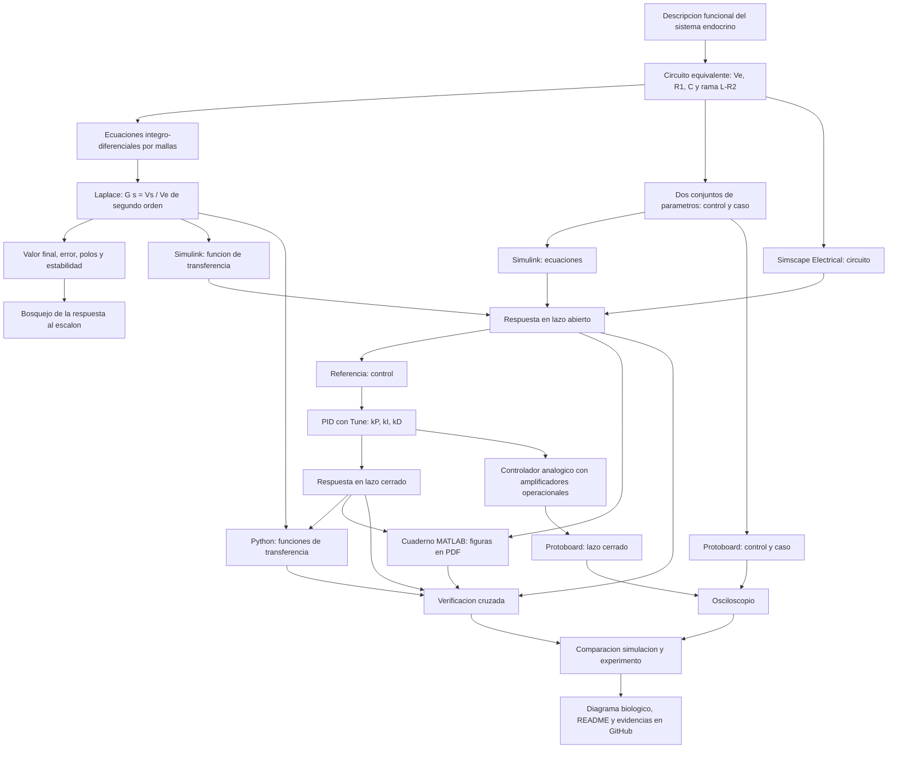

[](https://matlab.mathworks.com/open/github/v1?repo=KevinDarioITT/MSFP4)

# Práctica 4 — Modelado y control del sistema endócrino

> **Nota para el alumno:** confirma el número de práctica del título (aquí se supone la 4) y sustituye todos los marcadores **[COMPLETAR]** antes de entregar.

**Docente:** Dr. Paul Antonio Valle Trujillo  
**Correo:** paul.valle@tectijuana.edu.mx  
**Departamento:** Ingeniería Eléctrica y Electrónica  
**Institución:** Tecnológico Nacional de México / Instituto Tecnológico de Tijuana  
**Asignatura:** Modelado de Sistemas Fisiológicos  
**Programa:** Ingeniería Biomédica  
**Estudiante:** Kevin Dario De La Cruz Bojorquez · 20210777 · l20210777@tijuana.tecnm.mx

**Repositorio de la asignatura:** https://github.com/DrPaulValle/MSF-IBF1020  
**Sede:** Blvd. Alberto Limón Padilla s/n, Tijuana, C. P. 22454, B. C., México.

Repositorio académico de la asignatura **Modelado de Sistemas Fisiológicos**, correspondiente al programa de **Ingeniería Biomédica** del Tecnológico Nacional de México / Instituto Tecnológico de Tijuana. La práctica integra la interpretación de una descripción fisiológica, la construcción de una analogía eléctrica, análisis de estabilidad, diseño de un controlador PID, simulación computacional *in silico*, diseño de un controlador analógico con amplificadores operacionales y contraste con mediciones en el Laboratorio de Electrónica.

El caso de estudio representa de forma **fenomenológica** el proceso de secreción, transporte, almacenamiento y respuesta hormonal mediante un **circuito eléctrico de segundo orden** (instructivo, sección 5.6): una fuente $V_e(t)$ (estímulo), una resistencia $R_1$ (transporte), un capacitor $C$ (almacenamiento) y una rama $L$–$R_2$ en serie (respuesta del tejido diana y utilización). Se comparan una **condición de referencia** (control) y una **condición alterada** (caso) que difieren en **$C$ y $R_2$** ($1\ \mu\mathrm{F}$ y $100\ \mathrm{k}\Omega$ frente a $1000\ \mu\mathrm{F}$ y $1\ \mathrm{k}\Omega$), y se diseña un controlador PID que busca reducir la diferencia entre la respuesta del caso y la del control.

---

<a id="contenido"></a>
## Contenido

1. [Resumen](#resumen)
2. [Competencia y objetivos](#objetivos)
3. [Relación con el temario](#temario)
4. [Sistema fisiológico: el sistema endócrino](#fisiologico)
5. [Circuito eléctrico equivalente](#analogia)
6. [Formulación matemática](#modelo)
7. [Implementación en MATLAB, Simulink y Simscape](#matlab)
8. [Control en lazo cerrado y sintonización PID](#pid)
9. [Controlador analógico con amplificadores operacionales](#analogico)
10. [Reproducción en Python](#python)
11. [Diagrama biológico](#biologico)
12. [Resultados y verificación cruzada](#resultados)
13. [Implementación experimental](#experimental)
14. [Discusión y conclusiones](#discusion)
15. [Flujo de trabajo](#flujo)
16. [Actividades del estudiante](#actividades)
17. [Estructura del repositorio](#estructura)
18. [Requisitos](#requisitos)
19. [Reproducibilidad y entregables](#reproducibilidad)
20. [Referencias](#referencias)

---

<a id="resumen"></a>
## Resumen

La práctica tiene como propósito **modelar, analizar, simular, controlar y verificar experimentalmente** la respuesta hormonal normalizada de un compartimento endócrino mediante un circuito RLC de segundo orden. Con una analogía fenomenológica, el estímulo se representa con $V_e(t)$, el transporte con $R_1$, el almacenamiento temporal con $C$, el retardo o inercia de la respuesta con $L$ y la utilización o eliminación con $R_2$. La salida $V_s(t)$ representa el nivel hormonal efectivo y normalizado en el compartimento de interés.

Aplicando las leyes de Kirchhoff por mallas y la transformada de Laplace se obtiene la función de transferencia

$$
G(s)=\frac{V_s(s)}{V_e(s)}=\frac{Ls+R_2}{CLR_1\,s^2+(CR_1R_2+L)\,s+(R_1+R_2)},
$$

un sistema de **segundo orden** (dos elementos independientes de almacenamiento de energía: $C$ y $L$). Con los valores comerciales del instructivo, el control tiene polos en $s=-1010.01$ y $s=-999\,989.99\ \mathrm{s^{-1}}$ y el caso en $s=-2.0002$ y $s=-9998.99\ \mathrm{s^{-1}}$: ambos son **estables y sobreamortiguados**, con valores finales $G(0)=R_2/(R_1+R_2)$ de $0.990$ (control) y $0.5$ (caso). La alteración simulada, por tanto, **cambia tanto el valor final como la rapidez de la respuesta**: el caso es aproximadamente $500$ veces más lento y alcanza solo la mitad de la amplitud del control.

Posteriormente se construye un sistema de retroalimentación negativa que usa la respuesta del control como referencia para el caso, con un **controlador PID** en forma paralela con derivada filtrada ($k_P=400$, $k_I=1200$, $k_D=0.5$ y $N=2000$). El lazo cerrado es estable (cuatro polos reales negativos) y reduce el RMSE entre caso y control de $0.52$ a $\approx0.008\ \mathrm{V}$. Las ganancias se utilizan para calcular un controlador analógico con amplificadores operacionales. Los resultados se verifican de forma cruzada entre cinco implementaciones computacionales (ecuaciones, función de transferencia, Simscape Electrical, cuaderno de MATLAB y Python) y se contrastan con mediciones en protoboard.

La práctica no pretende representar un eje hormonal específico ni asociar los valores de los componentes con magnitudes fisiológicas medidas. La estrategia de control tiene propósitos **académicos y de simulación** y no constituye una estrategia terapéutica.

**Palabras clave:** sistema endócrino; analogía eléctrica; circuito RLC de segundo orden; función de transferencia; estabilidad; controlador PID; MATLAB; Simulink; Simscape Electrical; Python; amplificadores operacionales.

[Volver al contenido](#contenido)

---

<a id="objetivos"></a>
## Competencia y objetivos

### Competencia a desarrollar

Modeliza sistemas fisiológicos mediante analogías eléctricas, ecuaciones diferenciales y funciones de transferencia para analizar su comportamiento dinámico y diseña estrategias de control mediante técnicas de control clásico. En particular, durante la práctica el estudiante interpreta una descripción simplificada de los procesos de secreción, transporte, almacenamiento y respuesta hormonal para proponer un circuito eléctrico equivalente de segundo orden. Posteriormente, compara una condición de referencia (control) con una condición alterada (caso), diseña un controlador PID y contrasta los resultados obtenidos mediante modelado analítico, simulación computacional y experimentación en el Laboratorio de Electrónica.

### Objetivo general

Modelar y controlar la respuesta hormonal normalizada de un compartimento endócrino mediante un circuito eléctrico equivalente de segundo orden, comparando una condición de referencia con una condición alterada y contrastando los resultados analíticos, computacionales y experimentales.

### Objetivos específicos

- Construir el circuito equivalente a partir de la descripción funcional, identificando $V_e(t)$, $V_s(t)$, $R_1$, $C$, $L$, $R_2$, $F_e(t)$, $F_s(t)$, los nodos principales y la referencia.
- Obtener la función de transferencia $G(s)=V_s(s)/V_e(s)$ de control y caso, y relacionar su orden con los elementos $C$ y $L$.
- Determinar la respuesta final y el error en estado estacionario ante un escalón unitario.
- Calcular los polos, representarlos en el plano complejo, determinar la estabilidad y analizar el efecto de modificar $R_2$ y $C$.
- Formular el modelo con ecuaciones integro-diferenciales mediante las leyes de Kirchhoff.
- Implementar los modelos en Simulink (ecuaciones, función de transferencia) y Simscape Electrical (circuito), y comparar control y caso en lazo abierto.
- Construir el lazo de control con retroalimentación negativa y sintonizar un PID para el caso.
- Calcular un controlador PID analógico con amplificadores operacionales a partir de $k_P$, $k_I$ y $k_D$.
- Reproducir los resultados en MATLAB (cuaderno) y Python, y verificarlos de forma cruzada.
- Construir los circuitos en protoboard, registrar las respuestas con el osciloscopio y compararlas con la simulación.
- Elaborar un diagrama biológico y documentar la práctica en un repositorio de GitHub.

[Volver al contenido](#contenido)

---

<a id="temario"></a>
## Relación con el temario

La práctica integra contenidos de la asignatura **Modelado de Sistemas Fisiológicos (IBF-1020)**:

| Unidad | Área | Contenidos aplicados |
|---|---|---|
| I | Sistemas de control retroalimentados | Diagramas de bloques, retroalimentación negativa, señal de error, respuesta temporal y criterios de estabilidad |
| II | Modelado matemático | Analogías eléctricas, leyes de Kirchhoff, ecuaciones integro-diferenciales y funciones de transferencia |
| III | Controladores | Controlador PID, sintonización de ganancias, implementación analógica y análisis del desempeño en lazo cerrado |

El enfoque combina **Ingeniería de Control, Electrónica Analógica, Ciencias de la Computación y Fisiología**.

[Volver al contenido](#contenido)

---

<a id="fisiologico"></a>
## Sistema fisiológico: el sistema endócrino

Esta sección corresponde a la práctica **5.6 del instructivo** (*Modelado y control del sistema endócrino*) y describe el sistema fisiológico antes de pasar a su representación eléctrica.

### Descripción general

El **sistema endócrino** regula numerosos procesos fisiológicos mediante la liberación de **hormonas** producidas por glándulas especializadas. Una vez secretadas, estas moléculas son transportadas por la circulación hasta tejidos u órganos diana, donde interactúan con receptores específicos y producen respuestas cuya intensidad y duración dependen de la producción, el transporte, la distribución, el almacenamiento, la utilización y la eliminación de la hormona [1], [3].

La dinámica completa de un eje endócrino puede involucrar muchos compartimentos, mecanismos de retroalimentación y procesos bioquímicos. Para introducir el estudio de sistemas dinámicos mediante analogías eléctricas, estos procesos se representan con un modelo **fenomenológico simplificado** que reproduce de manera cualitativa propiedades como el **almacenamiento, la disipación, el retardo y la inercia** de la respuesta.

### Hipótesis del modelo y elementos del circuito

| Proceso fisiológico | Función en el modelo | Elemento eléctrico |
|---|---|---|
| **Estímulo** (señal neural, metabólica u homeostática) | Inicia la secreción hormonal | Fuente de voltaje $V_e(t)$ |
| **Secreción y transporte** de la hormona hacia el compartimento de efecto | Flujo asociado con la transferencia de la señal | Corriente $F_e(t)$ |
| **Pérdidas y oposición durante el transporte** | Reducen o retardan la transmisión de la señal | Resistencia $R_1$ |
| **Acumulación temporal** de hormona en un compartimento | Almacenamiento antes de su utilización o eliminación | Capacitancia $C$ |
| **Retardo o inercia de la respuesta** del tejido diana | Oposición dinámica a cambios rápidos de la respuesta | Inductancia $L$ |
| **Utilización, disipación o eliminación** de la señal | Oposición efectiva a la permanencia de la señal | Resistencia $R_2$ |
| **Respuesta del órgano diana** | Flujo asociado con la utilización | Corriente $F_s(t)$ |
| **Nivel hormonal efectivo y normalizado** | Variable de salida | Voltaje $V_s(t)$ |

Las correspondencias anteriores constituyen una **analogía fenomenológica con fines académicos**: las unidades y los valores de los componentes eléctricos no representan directamente magnitudes fisiológicas del sistema endócrino.

### Condición de referencia y condición alterada

El **control** representa la condición de referencia y el **caso** una condición alterada, definida en esta práctica de forma deliberadamente simple: se modifican **simultáneamente $C$ y $R_2$**, es decir, las propiedades de **almacenamiento** y de **disipación** del compartimento ($R_2$ baja de $100\ \mathrm{k}\Omega$ a $1\ \mathrm{k}\Omega$ y $C$ sube de $1\ \mu\mathrm{F}$ a $1000\ \mu\mathrm{F}$). El caso no se asocia con una enfermedad endócrina concreta; su finalidad es analizar cómo los cambios en esas propiedades modifican la respuesta temporal.

### Diagrama biológico y su relación con el circuito

*Figura 1 ([`Sistema Endocrino Biorender.pdf`](Sistema%20Endocrino%20Biorender.pdf)). Diagrama biológico del sistema endócrino (elaborado en BioRender) y su relación con los elementos del circuito eléctrico equivalente.*

El diagrama utiliza el eje **hipotálamo–hipófisis–tiroides** únicamente como **ejemplo ilustrativo** para relacionar cada elemento del circuito con un proceso fisiológico; el modelo eléctrico **no** representa este eje en particular ni incluye la retroalimentación fisiológica. La flecha roja con el signo menos ilustra la **retroalimentación negativa** característica de la homeostasis endócrina, análoga (pero no equivalente) al lazo de control con PID diseñado en la práctica.

| Etiqueta o elemento en la figura | Estructura que señala en el diagrama | Proceso fisiológico representado | Equivalente en el circuito |
|---|---|---|---|
| $V_e(t)$ (flecha hacia el cerebro) | Hipotálamo | Estímulo (señal neural, metabólica u homeostática) que inicia la secreción | Fuente de voltaje $V_e(t)$ |
| $R_1$ (línea hacia la base del hipotálamo) | Unión hipotálamo–hipófisis (tallo hipofisario) | Transporte de la señal hacia la hipófisis, con pérdidas y oposición | Resistencia $R_1$ |
| $C$ (línea hacia la glándula amarilla) | Hipófisis | Almacenamiento temporal y liberación de la hormona | Capacitor $C$ |
| Primera flecha roja hacia abajo (hipófisis → tiroides) | Circulación de la señal hormonal | Secreción y transporte hormonal hacia el órgano de efecto | Corriente $F_e(t)$ |
| $L$ (línea hacia el cuello) | Tiroides, como tejido diana de la señal hipofisaria | Retardo e inercia de la respuesta del tejido | Inductor $L$ |
| $V_s(t)$ (línea entre la tiroides y las células) | Nivel de señal disponible tras la respuesta del tejido | Nivel hormonal efectivo y normalizado | Voltaje $V_s(t)$ |
| Segunda flecha roja hacia abajo (tiroides → células) | Circulación hacia los tejidos diana | Flujo asociado con la utilización o respuesta del órgano diana | Corriente $F_s(t)$ |
| $R_2$ (línea hacia las células moradas con receptores) | Células diana | Utilización, disipación o eliminación de la señal | Resistencia $R_2$ |
| Flecha roja curva con signo menos | De las células diana de regreso a hipotálamo e hipófisis | Retroalimentación negativa (homeostasis); ilustrativa, no incluida en el circuito | Análoga al lazo de control con PID (no equivalente) |
| Recuadro inferior izquierdo | Circuito eléctrico | Resumen de la analogía | $V_e$, $R_1$, $C$, $L$, $R_2$ y $V_s(t)$ en el nodo $R_1$–$C$–$L$ |

*Las flechas $F_e(t)$ y $F_s(t)$ no están rotuladas en la figura; su asignación es una interpretación de las dos flechas rojas descendentes.*

**Nota sobre la figura.** En el circuito, $V_s(t)$ se mide en el nodo entre $R_1$, $C$ y $L$; en el diagrama, la etiqueta $V_s(t)$ se coloca junto a la salida de la cadena como indicador del **nivel hormonal efectivo**, de modo que se interpreta de forma cualitativa y no como la ubicación exacta del nodo. Asimismo, las etiquetas del diagrama se muestran como $R1$, $R2$ y $Ve(t)$, que corresponden a $R_1$, $R_2$ y $V_e(t)$ del reporte.

[Volver al contenido](#contenido)

---

<a id="analogia"></a>
## Circuito eléctrico equivalente

### Topología

A partir de la descripción funcional, el circuito tiene una **rama principal** formada por la fuente $V_e(t)$ y el resistor $R_1$. En el nodo posterior a $R_1$ se conecta el capacitor $C$ a la referencia, **en paralelo** con una segunda rama formada por el inductor $L$ y el resistor $R_2$ **en serie**. La salida $V_s(t)$ se mide en el nodo de unión entre $R_1$, $C$ y $L$.

```text
            R1             Vs(t)             L
   ┌───────/\/\/\──────────●───────────────ᘏᘏᘏ───┐
   │   →Fe(t)              │                      │
   │                       │                      │
 Ve(t)                    ═╧═ C                  ┬ →Fs(t)
  (±)                     ═╤═                    ┴ R2
   │                       │                      │
   └───────────────────────┴──────────────────────┘
                          ⏚ referencia
```

Debido a la presencia de dos elementos independientes de almacenamiento de energía, $C$ y $L$, el circuito es un sistema dinámico de **segundo orden**.

**[COMPLETAR]** Inserta aquí tu esquema del circuito (por ejemplo, el dibujo del cuaderno de prácticas o una captura de Simscape) con la entrada $V_e(t)$, la salida $V_s(t)$, los elementos, $F_e(t)$, $F_s(t)$, los nodos y la referencia.

### Variables y parámetros

| Símbolo | Equivalente eléctrico | Interpretación fisiológica |
|---|---|---|
| $V_e(t)$ | Fuente de voltaje de entrada | Estímulo que activa la secreción |
| $F_e(t)=i_1(t)$ | Corriente de la malla de entrada | Flujo de secreción y transporte |
| $R_1$ | Resistencia en la rama principal | Pérdidas y oposición durante el transporte |
| $C$ | Capacitor a la referencia | Acumulación temporal de hormona |
| $L$ | Inductor en la rama de respuesta | Retardo o inercia de la respuesta del tejido diana |
| $R_2$ | Resistencia en serie con $L$ | Utilización, disipación o eliminación |
| $F_s(t)=i_2(t)$ | Corriente de la rama $L$–$R_2$ | Flujo asociado con la respuesta del órgano diana |
| $V_s(t)$ | Voltaje en el nodo $R_1$–$C$–$L$ | Nivel hormonal efectivo y normalizado |

### Conjuntos de parámetros

| Componente | Control | Caso | Unidades |
|---|---:|---:|---|
| $R_1$ | $1$ | $1$ | $\mathrm{k}\Omega$ |
| $L$ | $100$ | $100$ | $\mathrm{mH}$ |
| $C$ | $1$ | $1000$ | $\mu\mathrm{F}$ |
| $R_2$ | $100$ | $1$ | $\mathrm{k}\Omega$ |
| $V_e(t)$ | $u(t)$ | $u(t)$ | $\mathrm{V}$ |

Los dos conjuntos comparten $R_1$ y $L$, y difieren en $C$ y $R_2$. La modificación simultánea produce una dinámica distinta entre las condiciones y permite analizar el efecto de las propiedades de almacenamiento y disipación sobre la respuesta temporal.

[Volver al contenido](#contenido)

---

<a id="modelo"></a>
## Formulación matemática

El desarrollo manuscrito se conserva en [`Cálculo Matemático.pdf`](Cálculo%20Matemático.pdf).

### 1. Ecuaciones integro-diferenciales (leyes de Kirchhoff)

Se definen dos corrientes de malla: $i_1(t)=F_e(t)$ en la malla de entrada ($V_e$, $R_1$, $C$) e $i_2(t)=F_s(t)$ en la malla de salida ($C$, $L$, $R_2$). El capacitor $C$ es compartido por ambas mallas:

$$
V_e(t)=R_1\,i_1(t)+\frac{1}{C}\int\big[i_1(t)-i_2(t)\big]\,dt,
$$

$$
0=L\frac{di_2(t)}{dt}+R_2\,i_2(t)+\frac{1}{C}\int\big[i_2(t)-i_1(t)\big]\,dt,
$$

$$
V_s(t)=L\frac{di_2(t)}{dt}+R_2\,i_2(t).
$$

Las variables asociadas con los dos elementos independientes de almacenamiento de energía son la **corriente del inductor** $i_2(t)$ y el **voltaje del capacitor** $V_s(t)$ (la carga acumulada $\int(i_1-i_2)\,dt=C\,V_s$).

### 2. Transformada de Laplace

Con condiciones iniciales nulas, y multiplicando por $Cs$:

$$
\text{(E2)}\quad 0=Cs\,(Ls+R_2)\,I_2(s)+I_2(s)-I_1(s),
$$

$$
\text{(E1)}\quad Cs\,V_e(s)=(CR_1s+1)\,I_1(s)-I_2(s),
$$

$$
\text{(E3)}\quad V_s(s)=(Ls+R_2)\,I_2(s).
$$

### 3. Obtención de la función de transferencia

De (E2) se despeja la corriente de entrada:

$$
I_1(s)=(CLs^2+CR_2s+1)\,I_2(s).
$$

Sustituyendo en (E1):

$$
Cs\,V_e(s)=\Big[(CR_1s+1)(CLs^2+CR_2s+1)-1\Big]I_2(s)
=\Big[C^2LR_1s^3+(C^2R_1R_2+CL)s^2+C(R_1+R_2)s\Big]I_2(s).
$$

Dividiendo entre $Cs$:

$$
V_e(s)=\Big[CLR_1\,s^2+(CR_1R_2+L)\,s+(R_1+R_2)\Big]I_2(s)
\;\Longrightarrow\;
F_s(s)=I_2(s)=\frac{V_e(s)}{CLR_1\,s^2+(CR_1R_2+L)\,s+(R_1+R_2)}.
$$

Sustituyendo $I_2(s)$ en (E3):

$$
\boxed{G(s)=\frac{V_s(s)}{V_e(s)}=\frac{Ls+R_2}{CLR_1\,s^2+(CR_1R_2+L)\,s+(R_1+R_2)}}
$$

Resultado equivalente al obtenido con el divisor de voltaje $V_s/V_e=Z/(R_1+Z)$, con $Z=(Ls+R_2)\,/\,(CLs^2+CR_2s+1)$. De forma análoga, la función de transferencia de los flujos es $F_e(s)/F_s(s)=CLs^2+CR_2s+1$.

El denominador es de **segundo grado** porque hay dos elementos independientes de almacenamiento ($C$ y $L$), y el numerador de primer grado, por lo que $G(s)$ es **estrictamente propia** (no hay salto inicial ante el escalón).

### 4. Funciones de transferencia de control y caso

| Condición | Numerador | Denominador | Forma mónica |
|---|---|---|---|
| Control ($C=1\ \mu\mathrm{F}$, $R_2=100\ \mathrm{k}\Omega$) | $0.1\,s+10^{5}$ | $10^{-4}s^2+100.1\,s+1.01\times10^{5}$ | $\dfrac{10^{3}s+10^{9}}{s^2+1.001\times10^{6}s+1.01\times10^{9}}$ |
| Caso ($C=1000\ \mu\mathrm{F}$, $R_2=1\ \mathrm{k}\Omega$) | $0.1\,s+10^{3}$ | $0.1\,s^2+1000.1\,s+2000$ | $\dfrac{s+10^{4}}{s^2+1.0001\times10^{4}s+2\times10^{4}}$ |

### 5. Respuesta final y error en estado estacionario

Para un escalón unitario $V_e(t)=u(t)$, por el teorema del valor final:

$$
V_s(\infty)=G(0)=\frac{R_2}{R_1+R_2},\qquad e_{ss}=1-G(0)=\frac{R_1}{R_1+R_2}.
$$

| Condición | $V_s(\infty)=G(0)$ | $e_{ss}=1-G(0)$ |
|---|---:|---:|
| Control | $\dfrac{100\ \mathrm{k}\Omega}{101\ \mathrm{k}\Omega}=0.990\ \mathrm{V}$ | $0.0099\ \mathrm{V}$ |
| Caso | $\dfrac{1\ \mathrm{k}\Omega}{2\ \mathrm{k}\Omega}=0.5\ \mathrm{V}$ | $0.5\ \mathrm{V}$ |

Como $L$ se comporta como un cortocircuito y $C$ como un circuito abierto en régimen permanente, el valor final solo depende del divisor $R_1$–$R_2$. La diferencia entre las respuestas finales de control y caso es $0.49\ \mathrm{V}$.

### 6. Polos, ceros y estabilidad

| Condición | Polos ($\mathrm{s^{-1}}$) | Cero ($\mathrm{s^{-1}}$) | $\omega_n$ ($\mathrm{rad/s}$) | $\zeta$ |
|---|---|---|---:|---:|
| Control | $s_1=-1010.01$, $s_2=-999\,989.99$ | $-10^{6}$ | $31\,780$ | $15.7$ |
| Caso | $s_1=-2.0002$, $s_2=-9998.99$ | $-10^{4}$ | $141.4$ | $35.4$ |

- Ambos sistemas tienen **dos polos reales y negativos** ($\zeta>1$): son **estables y sobreamortiguados**, sin oscilaciones ni sobreimpulso.
- En ambos, el polo rápido queda prácticamente cancelado por el cero ($-999\,990\approx-10^6$ en el control y $-9999\approx-10^4$ en el caso), de modo que cada respuesta se comporta, de forma aproximada, como un sistema de **primer orden** con el polo dominante:

| Condición | Polo dominante | $\tau\approx1/|s_1|$ | Respuesta aproximada |
|---|---:|---:|---|
| Control | $-1010.01$ | $0.99\ \mathrm{ms}$ | $V_s(t)\approx0.990\,(1-e^{-1010t})$ |
| Caso | $-2.0002$ | $0.50\ \mathrm{s}$ | $V_s(t)\approx0.5\,(1-e^{-2.0002t})$ |

- **Efecto de $R_2$ y $C$:** al aumentar $C$ (más almacenamiento) y disminuir $R_2$ (más disipación), el polo dominante pasa de $-1010$ a $-2$, la constante de tiempo crece de $\approx1\ \mathrm{ms}$ a $\approx0.5\ \mathrm{s}$ y el valor final cae de $0.990$ a $0.5\ \mathrm{V}$.
- Ante un escalón, $V_s(0^+)=0$ y la pendiente inicial vale $V_e/(R_1C)$: $1000\ \mathrm{V/s}$ en el control y $1\ \mathrm{V/s}$ en el caso.

### 7. Bosquejo de la respuesta temporal

Con base en los polos, la estabilidad y el error en estado estacionario se bosquejó (ver [`Cálculo Matemático.pdf`](Cálculo%20Matemático.pdf)) una curva monótona creciente y sobreamortiguada para cada condición: el control converge rápidamente a $0.99\ \mathrm{V}$ y el caso lo hace lentamente a $0.5\ \mathrm{V}$. Los bosquejos se conservan para compararlos con las simulaciones.

| Magnitud (escalón unitario) | Control | Caso |
|---|---:|---:|
| Valor final | $0.990\ \mathrm{V}$ | $0.5\ \mathrm{V}$ |
| Tiempo al $63.2\ \%$ del valor final | $\approx0.99\ \mathrm{ms}$ | $\approx0.50\ \mathrm{s}$ |
| Tiempo de establecimiento ($2\ \%$) | $\approx3.9\ \mathrm{ms}$ | $\approx1.96\ \mathrm{s}$ |
| Sobreimpulso | $0\ \%$ | $0\ \%$ |

*Valores obtenidos del cálculo analítico y verificados numéricamente en $t\in[0,10]\ \mathrm{s}$.*

[Volver al contenido](#contenido)

---

<a id="matlab"></a>
## Implementación en MATLAB, Simulink y Simscape

Para las dos condiciones (control y caso) se construyen tres representaciones equivalentes dentro del modelo de Simulink [`system.slx`](system.slx):

| Implementación | Descripción | Aspecto por verificar |
|---|---|---|
| Ecuaciones integro-diferenciales, Simulink | Bloques que implementan las ecuaciones de malla de $i_1$, $i_2$ y $V_s$ | Consistencia con las leyes de Kirchhoff |
| Función de transferencia (**FT**), Simulink | Bloque *Transfer Fcn* con $G(s)$ de cada condición | Respuesta de segundo orden sobreamortiguada |
| Circuito equivalente (**CE**), Simscape Electrical | $V_e$, $R_1$, $C$, $L$, $R_2$ conectados según el circuito | Concordancia con las representaciones matemáticas |

Las tres se verifican con las mismas condiciones iniciales (nulas) y la misma entrada (escalón unitario, $t\in[0,10]\ \mathrm{s}$).

**[COMPLETAR]** Configuración del *solver* y del paso máximo, y nombres de las señales de salida (por ejemplo `Vs: Control CE`, `Vs: Control FT`, `Vs: Caso CE`, `Vs: Caso FT` y `PID(t): Caso`).

### Ejecución desde el cuaderno MATLAB

El cuaderno ejecuta el modelo y envía al *Workspace* las señales mediante bloques *To Workspace*:

| Variable | Contenido |
|---|---|
| `x.t` | Tiempo de simulación |
| `x.Ve` | Señal de entrada $V_e(t)$ |
| `x.Vs_control` | Respuesta del **control** |
| `x.Vs_caso` | Respuesta del **caso** en lazo abierto |
| `x.Vs_PID` | Respuesta del **caso con controlador** |

**[COMPLETAR]** Ajusta los nombres de las variables a los de tu cuaderno.

La función de graficación:

1. representa gráficamente $V_e(t)$, el control, el caso y el sistema controlado;
2. identifica las variables y sus unidades ($V_e$, $V_s$ en $\mathrm{V}$ y $t$ en $\mathrm{s}$);
3. compara lazo abierto y lazo cerrado; y
4. guarda la figura en formato PDF ([`Control_caso_matlab.pdf`](Control_caso_matlab.pdf)).

[Volver al contenido](#contenido)

---

<a id="pid"></a>
## Control en lazo cerrado y sintonización PID

### 1. Esquema de control

La respuesta del **control** (individuo sano) se utiliza como **referencia** para el **caso** (Figura 5.5 del instructivo): la misma señal $V_e(t)$ excita ambos modelos, y la diferencia

$$
e(t)=V_{s,\text{control}}(t)-V_{s,\text{caso}}(t)
$$

es procesada por un PID que actúa sobre el sistema del caso (paciente/tratamiento), con retroalimentación negativa. La ley de control es

$$
u(t)=k_Pe(t)+k_I\int_0^t e(\tau)\,d\tau+k_D\frac{de(t)}{dt},\qquad K(s)=k_P+\frac{k_I}{s}+k_Ds.
$$

Con $G_{\text{caso}}(s)$ como planta, la función de transferencia de lazo cerrado y la salida controlada son

$$
T(s)=\frac{K(s)\,G_{\text{caso}}(s)}{1+K(s)\,G_{\text{caso}}(s)},\qquad
V_{s,\text{PID}}(s)=T(s)\,V_{s,\text{control}}(s).
$$

### 2. Sintonización

El controlador se sintoniza con la herramienta **Tune** del bloque *PID Controller* de Simulink, buscando una respuesta **estable** y una **reducción del error** entre el caso y la respuesta del control.

| Controlador | $k_P$ | $k_I$ | $k_D$ | Otros ajustes |
|---|---:|---:|---:|---|
| PID del caso | $400$ | $1200$ | $0.5$ | Forma paralela, tiempo continuo, fuente interna, derivada filtrada con $N=2000$ |

Los parámetros del bloque *PID Controller* de Simulink (*PID 1dof*) se conservan en [`Controlador.pdf`](Controlador.pdf):

*Figura 3 ([`Controlador.pdf`](Controlador.pdf)). Parámetros del bloque PID Controller: $P=400$, $I=1200$, $D=0.5$ y $N=2000$ (forma paralela, tiempo continuo).*

**[COMPLETAR]** Indica el criterio usado en *Tune* (tiempo de respuesta, ancho de banda, comportamiento transitorio) o, si las ganancias se ajustaron manualmente, cómo se eligieron; agrega la captura de la ventana de sintonización.

**Compensador.** El bloque implementa $K(s)=P+\dfrac{I}{s}+D\dfrac{N}{1+N/s}$, es decir,

$$
K(s)=k_P+\frac{k_I}{s}+\frac{k_DN\,s}{s+N}=\frac{(k_P+k_DN)s^2+(k_PN+k_I)s+k_IN}{s\,(s+N)}=\frac{1400\,s^2+801\,200\,s+2.4\times10^{6}}{s\,(s+2000)},
$$

con ceros en $s=-569.27$ y $s=-3.011\ \mathrm{s^{-1}}$ y polos en $s=0$ y $s=-2000\ \mathrm{s^{-1}}$.

**Lazo cerrado.** Con la planta del caso:

$$
T(s)=\frac{140\,s^3+1.48012\times10^{6}\,s^2+8.0144\times10^{8}\,s+2.4\times10^{9}}{0.1\,s^4+1340.1\,s^3+3.48232\times10^{6}\,s^2+8.0544\times10^{8}\,s+2.4\times10^{9}}.
$$

| Polos de $T(s)$ ($\mathrm{s^{-1}}$) | Ceros de $T(s)$ ($\mathrm{s^{-1}}$) |
|---|---|
| $-9998.80$, $-3146.51$, $-252.67$, $-3.019$ | $-10\,000$, $-569.27$, $-3.011$ |

Los cuatro polos son **reales y negativos**, por lo que el lazo cerrado es **estable**, y $T(0)=1$: el integrador hace que el error en estado estacionario ante una referencia constante sea cero. Los polos $-9998.8$ y $-3.019$ quedan casi cancelados por los ceros $-10\,000$ y $-3.011$, de modo que la dinámica dominante la determinan $-3146.5$ y $-252.7$ ($\tau\approx0.3$ y $4\ \mathrm{ms}$); frente a los $0.5\ \mathrm{s}$ del caso en lazo abierto, el controlador acelera la respuesta aproximadamente $100$ veces.

**Esfuerzo de control.** Con $k_P=400$ y un escalón unitario, la señal de control $u(t)$ alcanza un pico de $\approx294\ \mathrm{V}$ (en $t\approx0.64\ \mathrm{ms}$) y se estabiliza en $\approx1.98\ \mathrm{V}$ ($=0.990/0.5$, lo necesario para que el caso iguale al control). En simulación ideal esto no es un problema, pero un controlador analógico real se **saturaría** en los voltajes de alimentación de los amplificadores operacionales (ver [Controlador analógico](#analogico) e [Implementación experimental](#experimental)).

Como el instructivo indica, lo importante es justificar el criterio de sintonización y demostrar que el controlador es estable y reduce el error.

[Volver al contenido](#contenido)

---

<a id="analogico"></a>
## Controlador analógico con amplificadores operacionales

Las ganancias $k_P$, $k_I$ y $k_D$ se usan como especificaciones para calcular los resistores y capacitores de un PID analógico con amplificadores operacionales, que primero se construye en Simscape Electrical y se compara con el bloque ideal *PID Controller*.

**Especificaciones obtenidas de la sintonización:**

| Ganancia | Valor |
|---|---:|
| $k_P$ | $400$ |
| $k_I$ | $1200\ \mathrm{s^{-1}}$ |
| $k_D$ | $0.5\ \mathrm{s}$ |
| $N$ (filtro derivativo) | $2000\ \mathrm{rad/s}$ |

**Consideraciones prácticas.** $k_P=400$ implica una relación $R_f/R_i=400$ (por ejemplo, $R_i=1\ \mathrm{k}\Omega$ y $R_f=400\ \mathrm{k}\Omega$, valor no comercial que se aproxima con una combinación de resistores). Además, el esfuerzo de control teórico ($\approx294\ \mathrm{V}$ de pico) supera con mucho la alimentación simétrica de los amplificadores operacionales, por lo que el circuito real **saturará** al inicio del escalón y su respuesta diferirá de la simulación ideal. Conviene incluir en Simscape la saturación de los amplificadores para anticipar este efecto.

Una realización común en forma paralela (etapas inversoras en paralelo y un sumador) cumple, de forma ideal:

| Acción | Relación de diseño |
|---|---|
| Proporcional | $k_P=R_f/R_i$ |
| Integral | $k_I=1/(R_{I}C_{I})$ |
| Derivativa | $k_D=R_{D}C_{D}$ |

*(Las relaciones son orientativas: ajústalas a la topología que utilices y considera las inversiones de signo; la rama derivativa con resistencia en serie $R_s$ realiza $k_Ds/(1+s/N)$, equivalente a $k_DNs/(s+N)$ del bloque de Simulink. Los valores de la tabla son una propuesta de cálculo con valores comerciales; verifícalos en simulación antes de armar el circuito. Se requieren además un restador para $e(t)$ y un sumador inversor para combinar las tres ramas.)*

| Parámetro | Valor calculado | Valor comercial elegido |
|---|---:|---:|
| $R_i$, $R_f$ (proporcional, $k_P=400$) | $1\ \mathrm{k}\Omega$ y $400\ \mathrm{k}\Omega$ | $1\ \mathrm{k}\Omega$ y $390\ \mathrm{k}\Omega+10\ \mathrm{k}\Omega$ en serie |
| $R_I$, $C_I$ (integral, $k_I=1200$) | $8.33\ \mathrm{k}\Omega$ con $100\ \mathrm{nF}$ | $8.2\ \mathrm{k}\Omega$ y $100\ \mathrm{nF}$ ($k_I\approx1220$) |
| $R_D$, $C_D$ (derivativo, $k_D=0.5$) | $500\ \mathrm{k}\Omega$ con $1\ \mu\mathrm{F}$ | $510\ \mathrm{k}\Omega$ y $1\ \mu\mathrm{F}$ ($k_D\approx0.51$) |
| $R_s$ (filtro derivativo, $N=2000$) | $R_s=1/(NC_D)=500\ \Omega$ | $510\ \Omega$ ($N\approx1961$) |
| Amplificador operacional | — | **[COMPLETAR: por ejemplo, TL082 o LM358]** |
| Alimentación simétrica | — | **[COMPLETAR]** |

**[COMPLETAR]** Esquema del controlador analógico, cálculo detallado y comparación entre el PID analógico (Simscape) y el PID ideal.

[Volver al contenido](#contenido)

---

<a id="python"></a>
## Reproducción en Python

Como verificación independiente, se implementan en Python (Visual Studio Code) las funciones de transferencia del control y del caso con la biblioteca `control`. El código [`DLaCruz20210777.py`](DLaCruz20210777.py):

1. define el escalón unitario en $t\in[0,10]\ \mathrm{s}$;
2. obtiene las respuestas del control y del caso en lazo abierto;
3. incorpora las ganancias $k_P$, $k_I$ y $k_D$ obtenidas con *Tune*;
4. construye el sistema del caso en lazo cerrado con la respuesta del control como referencia;
5. imprime las funciones de transferencia, los polos y una tabla de verificación; y
6. genera la figura y la guarda como [`CasoyControl_Python.pdf`](CasoyControl_Python.pdf).

*Figura 2 ([`CasoyControl_Python.pdf`](CasoyControl_Python.pdf)). $V_e(t)$, $V_s(t)$ del control, del caso y del caso con controlador PID, obtenidas con Python.*

La figura muestra que el control converge casi de inmediato a $\approx0.99\ \mathrm{V}$, que el caso alcanza $0.5\ \mathrm{V}$ de forma lenta (en $\approx2$ s) y que la respuesta con controlador PID sigue a la del control.

Resultados que imprime el código (comparados con el cálculo analítico):

| Magnitud | Analítico | Simulado en Python | Simulink / MATLAB |
|---|---:|---:|---:|
| Control, valor final (V) | $0.990$ | **[COMPLETAR]** | **[COMPLETAR]** |
| Caso, valor final (V) | $0.500$ | **[COMPLETAR]** | **[COMPLETAR]** |
| Polos del control ($\mathrm{s^{-1}}$) | $-1010.01$; $-999\,989.99$ | **[COMPLETAR]** | — |
| Polos del caso ($\mathrm{s^{-1}}$) | $-2.0002$; $-9998.99$ | **[COMPLETAR]** | — |
| PID: valor final (V) | $\approx0.990$ | **[COMPLETAR]** | **[COMPLETAR]** |

Dependencias: `numpy`, `control` y `matplotlib` (`pip install numpy control matplotlib`).

[Volver al contenido](#contenido)

---

<a id="biologico"></a>
## Diagrama biológico

Se elabora un diagrama del sistema endócrino que relaciona los elementos del modelo con los procesos fisiológicos. El diagrama se presenta en la sección [Sistema fisiológico](#fisiologico) (Figura 1). Identifica como mínimo: la glándula o fuente de secreción, el estímulo, el transporte de la hormona, el compartimento de almacenamiento, el tejido u órgano diana y la respuesta.

| Elemento del diagrama | Representación en el modelo | Equivalente eléctrico |
|---|---|---|
| Estímulo (señal neural, metabólica u homeostática) | Señal de entrada | Fuente $V_e(t)$ |
| Secreción y transporte | Flujo hormonal con pérdidas | Corriente $F_e(t)$ y resistencia $R_1$ |
| Compartimento de almacenamiento | Acumulación temporal | Capacitor $C$ |
| Tejido diana (retardo de respuesta) | Inercia de la respuesta | Inductor $L$ |
| Utilización o eliminación | Disipación de la señal | Resistencia $R_2$ y corriente $F_s(t)$ |
| Nivel hormonal efectivo | Salida normalizada | Voltaje $V_s(t)$ |

[Volver al contenido](#contenido)

---

<a id="resultados"></a>
## Resultados y verificación cruzada

### 1. Respuesta en lazo abierto

Se aplica el mismo escalón unitario al control y al caso durante $t\in[0,10]\ \mathrm{s}$ y se registra $V_s(t)$.

**Observaciones.**

- El **control** alcanza $0.990\ \mathrm{V}$ en pocos milisegundos ($\tau\approx1\ \mathrm{ms}$, establecimiento al $2\ \%$ en $\approx3.9\ \mathrm{ms}$).
- El **caso** sube de forma exponencial y alcanza solo $0.5\ \mathrm{V}$, con $\tau\approx0.5\ \mathrm{s}$ y un establecimiento al $2\ \%$ en $\approx1.96\ \mathrm{s}$.
- Ninguna respuesta presenta sobreimpulso (polos reales, sobreamortiguados).
- La diferencia entre ambas respuestas es máxima poco después del inicio del escalón ($\approx0.98\ \mathrm{V}$ hacia $t\approx7\ \mathrm{ms}$) y se reduce a $0.49\ \mathrm{V}$ en régimen permanente; la raíz del error cuadrático medio en $[0,10]\ \mathrm{s}$ es $\mathrm{RMSE}\approx0.52\ \mathrm{V}$.
- Estas observaciones coinciden con el análisis previo: **distinto valor final y distinta dinámica**, por la modificación de $C$ y $R_2$.

### 2. Respuesta en lazo cerrado

Se comparan $V_{s,\text{control}}(t)$, $V_{s,\text{caso}}(t)$ y $V_{s,\text{PID}}(t)$.

Con $k_P=400$, $k_I=1200$, $k_D=0.5$ y $N=2000$ se obtiene (cálculo analítico en $t\in[0,10]\ \mathrm{s}$; compáralo con tu simulación):

- La salida controlada **sigue a la referencia**: converge a $0.990\ \mathrm{V}$ (error en estado estacionario nulo respecto del control), frente a los $0.5\ \mathrm{V}$ del caso sin controlador.
- **Rapidez:** alcanza el $63\ \%$ del valor final en $\approx3.2\ \mathrm{ms}$ y entra a la banda de $\pm2\ \%$ en $\approx14\ \mathrm{ms}$ (control: $\approx1\ \mathrm{ms}$ y $3.9\ \mathrm{ms}$; caso sin controlador: $\approx0.5\ \mathrm{s}$ y $1.96\ \mathrm{s}$).
- **Transitorio:** sobreimpulso pequeño de $0.0022\ \mathrm{V}$ ($\approx0.2\ \%$ del valor final) hacia $t\approx41\ \mathrm{ms}$.
- **Error:** la diferencia máxima respecto del control baja de $0.98\ \mathrm{V}$ (lazo abierto) a $\approx0.41\ \mathrm{V}$ y ocurre en el primer milisegundo ($t\approx1.5\ \mathrm{ms}$), pues el control es mucho más rápido que el caso controlado.
- La ganancia alta ($k_P=400$) exige un esfuerzo de control muy grande al inicio (ver sección anterior).

### 3. Métricas del error

Raíz del error cuadrático medio entre la referencia y la salida, $\mathrm{RMSE}=\sqrt{\frac{1}{T}\int_0^T e^2(t)\,dt}$, en $t\in[0,10]\ \mathrm{s}$:

| Caso | RMSE lazo abierto (V) | RMSE lazo cerrado (V) | Reducción |
|---|---:|---:|---:|
| Alteración simulada | $0.52$ | $0.008$ | $\approx98.5\ \%$ |

### 4. Verificación cruzada entre plataformas

Se comparan las respuestas obtenidas con (a) las ecuaciones integro-diferenciales en Simulink, (b) la función de transferencia en Simulink, (c) el circuito en Simscape Electrical, (d) el cuaderno de MATLAB y (e) el código de Python.

| Condición | Ecuaciones (Simulink) | Función de transferencia (Simulink) | Simscape (CE) | Cuaderno MATLAB | Python | ¿Consistentes? |
|---|:---:|:---:|:---:|:---:|:---:|:---:|
| Control | **[COMPLETAR]** | **[COMPLETAR]** | **[COMPLETAR]** | **[COMPLETAR]** | **[COMPLETAR]** | **[COMPLETAR]** |
| Caso | **[COMPLETAR]** | **[COMPLETAR]** | **[COMPLETAR]** | **[COMPLETAR]** | **[COMPLETAR]** | **[COMPLETAR]** |
| Caso con PID | **[COMPLETAR]** | **[COMPLETAR]** | **[COMPLETAR]** | **[COMPLETAR]** | **[COMPLETAR]** | **[COMPLETAR]** |

Las diferencias que aparezcan pueden asociarse con el método numérico (*solver*), el paso máximo de integración o la implementación de los modelos. Nota: los polos del control ($\approx-10^6\ \mathrm{s^{-1}}$) son muy rápidos, por lo que un paso de integración grande puede afectar la respuesta inicial.

### Archivos de resultados

| Resultado | MATLAB/Simulink | Python |
|---|---|---|
| Control, caso y caso con PID | [`Control_caso_matlab.pdf`](Control_caso_matlab.pdf) | [`CasoyControl_Python.pdf`](CasoyControl_Python.pdf) |
| Parámetros del PID | [`Controlador.pdf`](Controlador.pdf) | — |

[Volver al contenido](#contenido)

---

<a id="experimental"></a>
## Implementación experimental

### 1. Lazo abierto

Se construyen en protoboard los circuitos de control y caso con los valores comerciales especificados. Se configura el generador de funciones para producir una **aproximación experimental al escalón unitario** (por ejemplo, una onda cuadrada de baja frecuencia y bajo ciclo de trabajo) y se registran simultáneamente $V_e(t)$ y $V_s(t)$ con el osciloscopio.

Como las constantes de tiempo son muy distintas ($\approx1\ \mathrm{ms}$ en el control y $\approx0.5\ \mathrm{s}$ en el caso), el **periodo de la señal debe ser mayor que $\approx5\tau$** de cada circuito (del orden de decenas de milisegundos para el control y de varios segundos para el caso), y la escala temporal del osciloscopio se ajusta en consecuencia.

Las señales se registraron simultáneamente en una sola captura ([`CasoyControl_Lab.pdf`](CasoyControl_Lab.pdf)), con la siguiente asignación de canales:

| Canal | Color | Señal |
|---|---|---|
| CH1 | Amarillo | Entrada $V_e(t)$ |
| CH2 | Azul | Caso con controlador PID |
| CH3 | Naranja | Control |
| CH4 | Verde | Caso (lazo abierto) |

| Parámetro del osciloscopio | Valor |
|---|---|
| Escala vertical | $500\ \mathrm{mV/div}$ en los cuatro canales |
| Escala horizontal | $500\ \mathrm{ms/div}$ |
| Muestreo | $500\ \mathrm{S/s}$ (una muestra cada $2\ \mathrm{ms}$), profundidad de $10\mathrm{K}$ |
| Entrada $V_e(t)$ (CH1) | Máximo $1.000\ \mathrm{V}$, mínimo $20\ \mathrm{mV}$, $V_{pp}=980\ \mathrm{mV}$ |

**[COMPLETAR]** Frecuencia, amplitud y ciclo de trabajo configurados en el generador de funciones (en la ventana de $\approx7\ \mathrm{s}$ no se observa la bajada de la señal, por lo que el periodo es mayor que unos $5\ \mathrm{s}$).

*Figura 4 ([`CasoyControl_Lab.pdf`](CasoyControl_Lab.pdf)). Captura del osciloscopio: entrada, control, caso y caso con PID.*

### 2. Lazo cerrado

Se construye el controlador analógico y se conecta con el circuito del caso, con la alimentación simétrica de los amplificadores operacionales según las especificaciones del laboratorio. Se registran las respuestas en lazo abierto y en lazo cerrado.

En la captura de la Figura 4, el caso con controlador (CH2) alcanza un valor cercano al de la entrada y del control, a diferencia del caso en lazo abierto (CH4), que se queda en torno a $0.45\ \mathrm{V}$. Se observa que el controlador acelera la respuesta del caso, aunque no tanto como predice la simulación (ver discusión).

**[COMPLETAR]** Fotografías del montaje y valores medidos con cursores (valor final y constante de tiempo de cada canal).

### 3. Comparación entre simulación y experimentación

| Magnitud | Simulación | Experimento | Diferencia |
|---|---:|---:|---:|
| Control, valor final (V) | $0.990$ | $\approx1$ (no resoluble a $500\ \mathrm{mV/div}$) | $<0.02$ |
| Caso, valor final (V) | $0.5$ | $\approx0.45$ | $\approx0.05$ ($\approx10\ \%$) |
| Control, $\tau$ | $\approx1\ \mathrm{ms}$ | No resoluble (muestreo de $2\ \mathrm{ms}$) | — |
| Caso, establecimiento | $\approx1.96\ \mathrm{s}$ ($\tau\approx0.5\ \mathrm{s}$) | $\approx1.7$–$2\ \mathrm{s}$ | Consistente |
| Caso con PID, valor final (V) | $\approx0.990$ | $\approx1$ (no resoluble a $500\ \mathrm{mV/div}$) | $<0.05$ |
| Caso con PID, establecimiento | $\approx14\ \mathrm{ms}$ | $\approx0.1$–$0.15\ \mathrm{s}$ | Más lento que la simulación |

*Los valores experimentales son lecturas aproximadas de la captura (Figura 4); **[COMPLETAR]** confírmalos con los cursores del osciloscopio. Con $500\ \mathrm{mV/div}$ no se distingue entre $0.99$ y $1\ \mathrm{V}$ (equivale a $0.02$ divisiones), y con $500\ \mathrm{S/s}$ no se resuelve la constante de tiempo de $\approx1\ \mathrm{ms}$ del control.*
Las diferencias se analizan considerando:

- tolerancias de resistores, capacitores e inductores;
- resistencia interna y comportamiento no ideal del inductor (la resistencia serie del inductor suma a $R_2$ y modifica el valor final);
- tolerancia y resistencia serie equivalente del capacitor (el de $1000\ \mu\mathrm{F}$ suele ser electrolítico: respeta su polaridad);
- valores comerciales utilizados en el controlador;
- características no ideales de los amplificadores operacionales;
- limitaciones de los instrumentos de medición (impedancia de entrada y ancho de banda de la punta); y
- aproximación experimental utilizada para generar el escalón.

**Discusión de las diferencias observadas.**

- **Caso en lazo abierto.** El valor final medido ($\approx0.45\ \mathrm{V}$) es menor que el esperado ($0.5\ \mathrm{V}$), mientras que el tiempo de establecimiento ($\approx2\ \mathrm{s}$) coincide con la simulación. Como el valor final depende solo de $R_2/(R_1+R_2)$, una disminución de $\approx10\ \%$ es compatible con la resistencia serie del inductor y del generador, que modifican el divisor, y con la fuga o la tolerancia del capacitor electrolítico de $1000\ \mu\mathrm{F}$ (hipótesis por confirmar midiendo los componentes).
- **Control.** La respuesta (CH3) queda prácticamente superpuesta con la entrada: con $\tau\approx1\ \mathrm{ms}$ y un muestreo de $2\ \mathrm{ms}$, el osciloscopio no puede resolver la subida en esta escala de tiempo.
- **Caso con PID.** El controlador acerca la respuesta del caso al nivel del control y la acelera en más de un orden de magnitud respecto del lazo abierto ($\approx0.1\ \mathrm{s}$ frente a $\approx2\ \mathrm{s}$), pero es más lento que lo que predice la simulación ideal ($\approx14\ \mathrm{ms}$). Una causa probable es la **saturación** y la limitación de velocidad (*slew rate*) de los amplificadores operacionales, ya que el esfuerzo de control teórico ($\approx294\ \mathrm{V}$) supera la alimentación del circuito (hipótesis por confirmar al incluir la saturación en Simscape).

[Volver al contenido](#contenido)

---

<a id="discusion"></a>
## Discusión y conclusiones

### Discusión

**Efecto de $C$ y $R_2$ en la dinámica.** El control y el caso son sistemas de segundo orden **estables y sobreamortiguados**. Al aumentar $C$ de $1\ \mu\mathrm{F}$ a $1000\ \mu\mathrm{F}$ y disminuir $R_2$ de $100\ \mathrm{k}\Omega$ a $1\ \mathrm{k}\Omega$, el polo dominante pasa de $-1010$ a $-2\ \mathrm{s^{-1}}$ y el valor final de $0.990$ a $0.5\ \mathrm{V}$. En términos del modelo, un compartimento con mayor capacidad de almacenamiento y mayor disipación produce una respuesta hormonal normalizada **más lenta y de menor amplitud**.

**Orden efectivo.** Aunque $G(s)$ es de segundo orden, el cero cercano al polo rápido hace que ambas respuestas se comporten de forma aproximada como sistemas de primer orden: la inercia asociada con $L$ no produce oscilaciones porque el sistema está fuertemente sobreamortiguado ($\zeta=15.7$ y $35.4$).

**Lazo abierto.** **[COMPLETAR]** Compara la simulación con las predicciones analíticas y con los bosquejos.

**Lazo cerrado.** El PID ($k_P=400$, $k_I=1200$, $k_D=0.5$, $N=2000$) logra que el caso alcance el valor final del control ($0.990\ \mathrm{V}$) y reduce el RMSE de $0.52$ a $\approx0.008\ \mathrm{V}$, con un sobreimpulso del orden de $0.2\ \%$. El compromiso es el **esfuerzo de control**: el pico de $\approx294\ \mathrm{V}$ no es realizable con amplificadores operacionales convencionales. **[COMPLETAR]** Compromisos observados durante la sintonización.

**Verificación entre plataformas y experimento.** El experimento reproduce la tendencia de la simulación: el control es casi instantáneo, el caso es lento y se estabiliza en un valor menor, y el PID acerca el caso al control. Las diferencias principales (valor final del caso y rapidez del PID) se atribuyen a componentes reales y a la saturación de los amplificadores operacionales. **[COMPLETAR]** Concordancia entre Simulink, Simscape, MATLAB y Python.

**Limitaciones.** El modelo es lineal, de parámetros concentrados y de segundo orden; no representa un eje hormonal específico ni incluye retroalimentación fisiológica, pulsatilidad ni no linealidades. Los valores de los componentes no se asocian con mediciones fisiológicas y la entrada escalón es un estímulo idealizado.

### Conclusiones

- La descripción funcional del sistema endócrino se traduce en un circuito RLC de segundo orden con $G(s)=\dfrac{Ls+R_2}{CLR_1s^2+(CR_1R_2+L)s+(R_1+R_2)}$.
- Control y caso son **estables** (polos reales negativos) y **sobreamortiguados**; el control alcanza $0.990\ \mathrm{V}$ con $\tau\approx1\ \mathrm{ms}$ y el caso $0.5\ \mathrm{V}$ con $\tau\approx0.5\ \mathrm{s}$.
- El error en estado estacionario es $0.0099\ \mathrm{V}$ en el control y $0.5\ \mathrm{V}$ en el caso: la alteración modifica **tanto la amplitud final como la rapidez** de la respuesta.
- El controlador PID ($k_P=400$, $k_I=1200$, $k_D=0.5$, $N=2000$) produce un lazo cerrado **estable** que lleva al caso a $0.990\ \mathrm{V}$ en $\approx14\ \mathrm{ms}$ (frente a $\approx2\ \mathrm{s}$ sin control) y reduce el RMSE respecto del control en $\approx98.5\ \%$, a costa de un esfuerzo de control elevado.
- La experimentación confirma de forma cualitativa el modelo: el caso es mucho más lento que el control ($\approx2\ \mathrm{s}$ frente a milisegundos) y el PID lo acerca al control, con diferencias atribuibles a los componentes reales y a la saturación de los amplificadores operacionales.
- La estrategia de control desarrollada tiene **fines académicos y de simulación** y **no** constituye una estrategia terapéutica.

[Volver al contenido](#contenido)

---

<a id="flujo"></a>
## Flujo de trabajo



[Volver al contenido](#contenido)

---

<a id="actividades"></a>
## Actividades del estudiante

La práctica sigue la secuencia de 19 actividades del instructivo (marca las que hayas completado).

### Etapa 1. Modelo y análisis

- [ ] 1. Construir el circuito equivalente (control y caso) identificando $V_e$, $V_s$, $R_1$, $C$, $L$, $R_2$, $F_e$, $F_s$, nodos y referencia.
- [ ] 2. Obtener $G(s)=V_s(s)/V_e(s)$ para control y caso y relacionar el orden con $C$ y $L$.
- [ ] 3. Calcular la respuesta final y el error en estado estacionario ante un escalón unitario.
- [ ] 4. Calcular los polos, ubicarlos en el plano complejo y determinar la estabilidad; analizar el efecto de $R_2$ y $C$.
- [ ] 5. Elaborar el bosquejo de la respuesta temporal de control y caso.
- [ ] 6. Formular el modelo con ecuaciones integro-diferenciales (leyes de Kirchhoff).

### Etapa 2. Simulación en lazo abierto

- [ ] 7. Implementar ecuaciones, función de transferencia y circuito Simscape para control y caso.
- [ ] 8. Analizar la respuesta en lazo abierto en $t\in[0,10]$ s.

### Etapa 3. Control

- [ ] 9. Construir el sistema de control con retroalimentación negativa y bloque PID.
- [ ] 10. Sintonizar el PID con *Tune* y registrar $k_P$, $k_I$, $k_D$ y la evidencia.
- [ ] 11. Analizar las respuestas en lazo cerrado.

### Etapa 4. Reproducción, controlador analógico y verificación

- [ ] 12. Desarrollar el cuaderno de MATLAB y la función de graficación (figuras en PDF).
- [ ] 13. Implementar el código en Python y comparar con MATLAB/Simulink.
- [ ] 14. Diseñar el controlador analógico con amplificadores operacionales y compararlo con el PID ideal.
- [ ] 15. Realizar la verificación cruzada de las cinco implementaciones.

### Etapa 5. Experimentación y documentación

- [ ] 16. Implementar experimentalmente control y caso en lazo abierto (protoboard, generador y osciloscopio).
- [ ] 17. Implementar experimentalmente el controlador analógico en lazo cerrado.
- [ ] 18. Comparar simulación y experimentación y analizar las diferencias.
- [ ] 19. Documentar en GitHub: este `README.md` y un `CITATION.cff` con los datos del alumno y del repositorio.

[Volver al contenido](#contenido)

---

<a id="estructura"></a>
## Estructura del repositorio

Archivos del repositorio:

```text
.
├── CasoyControl_Python.pdf            # Figura generada con Python
├── Control_caso_matlab.pdf            # Figura generada con MATLAB (control, caso y caso con PID)
├── CasoyControl_Lab.pdf               # Captura del osciloscopio (experimento)
├── Controlador.pdf                    # Parámetros del bloque PID Controller
├── Cálculo Matemático.pdf             # Desarrollo manuscrito: circuito, ecuaciones y Laplace
├── DLaCruz20210777.py                 # Implementación en Python
├── DeLaCruz20210777.mlx               # Cuaderno MATLAB
├── DeLaCruz20210777.pdf               # Exportación del cuaderno MATLAB
├── LICENSE                            # Licencia del repositorio
├── README.md                          # Reporte de la práctica
├── Sistema Endocrino Biorender.pdf    # Diagrama biológico (BioRender)
└── system.slx                         # Modelo Simulink (ecuaciones, FT, control, Simscape, PID)
```

**Pendiente de agregar** (según el instructivo): fotografías de los montajes, el cálculo del controlador analógico y el archivo `CITATION.cff`.

[Volver al contenido](#contenido)

---

<a id="requisitos"></a>
## Requisitos

- **MATLAB** y **Simulink**.
- **Simscape Electrical**, para el circuito equivalente y el controlador analógico.
- Herramientas de Simulink para sintonización del bloque **PID Controller** (*Tune*).
- **Control System Toolbox**, para las funciones `tf`, `pole`, `zero`, `dcgain` y `pzmap`.
- **Python** y **Visual Studio Code**, con las bibliotecas `numpy`, `control` y `matplotlib`.
- **Laboratorio de Electrónica**: protoboard, generador de funciones, osciloscopio, fuente simétrica, amplificadores operacionales, resistores, capacitores e inductor.
- **Git y GitHub**, para organizar y presentar el repositorio.
- **BioRender** o herramienta equivalente, para el diagrama biológico.

[Volver al contenido](#contenido)

---

<a id="reproducibilidad"></a>
## Reproducibilidad y entregables

### Secuencia de reproducción

1. Descargar el repositorio y abrir el cuaderno de MATLAB (o usar el botón *Open in MATLAB Online*).
2. Verificar los parámetros de control y caso (tabla de parámetros) y la entrada (escalón unitario, $t\in[0,10]$ s).
3. Ejecutar el modelo de Simulink (ecuaciones, función de transferencia y Simscape) y verificar su consistencia.
4. Ejecutar el cuaderno para obtener las respuestas del control, del caso y del caso con PID, y exportar la figura en PDF.
5. Ejecutar el código de Python con las ganancias PID registradas.
6. Comparar los resultados entre plataformas y con las mediciones experimentales.

### Entregables solicitados en el repositorio

| Entregable | Evidencia |
|---|---|
| Interpretación fisiológica del modelo | Sección [Sistema fisiológico](#fisiologico) (este README) |
| Circuito eléctrico propuesto | Sección [Circuito eléctrico equivalente](#analogia) |
| Desarrollo matemático | Sección [Formulación matemática](#modelo) y [`Cálculo Matemático.pdf`](Cálculo%20Matemático.pdf) |
| Funciones de transferencia de control y caso | Tabla de la sección [Formulación matemática](#modelo) |
| MATLAB y Simulink | Cuaderno [`DeLaCruz20210777.mlx`](DeLaCruz20210777.mlx) (exportado en [`DeLaCruz20210777.pdf`](DeLaCruz20210777.pdf)) y modelo [`system.slx`](system.slx) |
| Simscape Electrical | Circuito equivalente dentro del modelo de Simulink |
| Python | Código fuente [`DLaCruz20210777.py`](DLaCruz20210777.py) |
| Figuras | [`Control_caso_matlab.pdf`](Control_caso_matlab.pdf) y [`CasoyControl_Python.pdf`](CasoyControl_Python.pdf) |
| Ganancias de la sintonización | Sección [Control en lazo cerrado](#pid) |
| Cálculo del controlador analógico | Sección [Controlador analógico](#analogico) |
| Fotografías de los montajes | Carpeta de fotografías |
| Capturas del osciloscopio | [`CasoyControl_Lab.pdf`](CasoyControl_Lab.pdf) |
| Comparación simulación–experimento | Sección [Implementación experimental](#experimental) |
| Documentación | `README.md` (reporte) y `CITATION.cff` |

### Criterios de presentación académica

Este README funciona como **reporte** de la práctica: describe la interpretación del sistema endócrino, la construcción de la analogía eléctrica, el modelo matemático, las diferencias entre control y caso, el diseño del controlador, los resultados computacionales y experimentales, la discusión y las conclusiones. Debe distinguirse entre los resultados obtenidos por el alumno y cualquier material de referencia proporcionado por la asignatura.

[Volver al contenido](#contenido)

---

<a id="referencias"></a>
## Referencias

[1] M. C. Khoo, *Physiological Control Systems: Analysis, Simulation, and Estimation*, 2nd ed., IEEE Press, 2018.

[2] F. C. Hoppensteadt y C. S. Peskin, *Modeling and Simulation in Medicine and the Life Sciences*, Springer.

[3] J. E. Hall, *Guyton and Hall Textbook of Medical Physiology*, 14th ed., Elsevier, 2021.

[4] K. Ogata, *Ingeniería de Control Moderna*, 5.ª ed., Pearson Educación, 2010.

[5] N. S. Nise, *Control Systems Engineering*, 8th ed., John Wiley & Sons, 2020.

[6] P. A. Valle, *Syllabus para Modelado de Sistemas Fisiológicos*, Tecnológico Nacional de México / Instituto Tecnológico de Tijuana, Tijuana, B. C., México, 2026. Disponible en: https://biomath.xyz/course/

[7] Tecnológico Nacional de México, *Programa de estudio de la asignatura Modelado de Sistemas Fisiológicos, IBF-1020*.

---

## Uso académico

Este repositorio se utiliza como evidencia de la práctica **Modelado y control del sistema endócrino** de la asignatura **Modelado de Sistemas Fisiológicos**. El modelo es una analogía fenomenológica con fines académicos y no representa un eje hormonal específico. La estrategia de control desarrollada tiene propósitos exclusivamente académicos y de simulación y no constituye una estrategia terapéutica.
